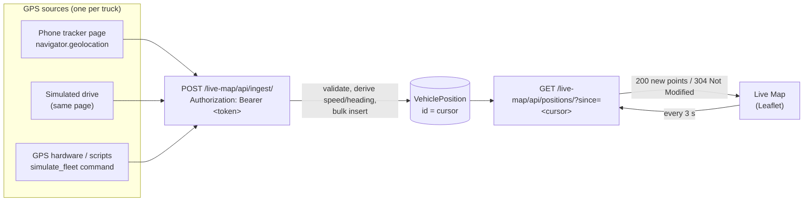

# Fleet Management System

A Django web application for running a road-freight fleet day to day: who is driving which truck on which route, what each load earned, what fuel cost, which licences are about to expire, and where every truck is right now.

It is built around the way a South African haulage operation works: trucks run fixed routes (for example Johannesburg → Durban), revenue is earned per ton per load at a route's transport rate, fuel is the main running cost, and controllers hand over between day and night shifts.

**Stack:** Python 3.10+ · Django 5.1 · SQLite (PostgreSQL via Docker) · Bootstrap 5 · Leaflet · openpyxl

---

## Contents

- [Feature overview](#feature-overview)
- [Features in detail](#features-in-detail)
  - [Dashboard and compliance warnings](#dashboard-and-compliance-warnings)
  - [Vehicle management](#vehicle-management)
  - [Route management](#route-management)
  - [Driver, vehicle and route assignments](#driver-vehicle-and-route-assignments)
  - [Daily revenue reports](#daily-revenue-reports)
  - [Daily cost reports and fuel rates](#daily-cost-reports-and-fuel-rates)
  - [Bookkeeping and Excel exports](#bookkeeping-and-excel-exports)
  - [Analytics and finance](#analytics-and-finance)
  - [Live Map (real-time GPS tracking)](#live-map-real-time-gps-tracking)
  - [People: drivers, controllers, clients and sites](#people-drivers-controllers-clients-and-sites)
  - [Controller activity log and shift handover](#controller-activity-log-and-shift-handover)
  - [CRM and prospecting](#crm-and-prospecting)
  - [Deliveries](#deliveries)
  - [FleetCam integration](#fleetcam-integration)
  - [Weather and AI assistant pages](#weather-and-ai-assistant-pages)
- [How live tracking works](#how-live-tracking-works)
- [Getting started](#getting-started)
- [Project structure](#project-structure)
- [Configuration](#configuration)
- [Running the tests](#running-the-tests)
- [Production notes](#production-notes)
- [Troubleshooting](#troubleshooting)
- [URL reference](#url-reference)
- [Changelog](#changelog)

---

## Feature overview

| Area | What it does |
|---|---|
| **Live Map** | Real-time GPS positions of every truck, with trails, speed, heading and offline detection. Fed by phone trackers, GPS hardware or a built-in simulator through a token-authenticated API. |
| **Vehicles** | Fleet register with registration expiry, active status, FleetCam link and current assignments. |
| **Routes** | Start/finish, transport rate per ton and planned revenue per load, with variance. |
| **Assignments** | Driver ↔ vehicle ↔ route assignments by shift (day/night), including a drag-and-drop board. |
| **Revenue** | Daily revenue reports per driver: loads × tonnage × route rate, with a running predicted revenue. |
| **Costs** | Daily fuel cost reports at the active fuel rate, with a running predicted cost. |
| **Bookkeeping** | Revenue vs cost vs target by vehicle, driver and route, exportable as a 5-sheet Excel workbook. |
| **Analytics** | Cost/revenue analytics, fuel price trends and a consolidated dashboard. |
| **Compliance** | Warnings for driver licences, induction licences and vehicle registrations expiring within 30 days. |
| **People** | Drivers, controllers, clients and sites, plus a controller activity log and shift handover dashboard. |
| **CRM** | Sales agents, clients, interactions, performance and a prospect approval queue. |

---

## Features in detail

### Dashboard and compliance warnings

The home page (`/`) is the landing page after login. It summarises how many drivers have documents expiring within **30 days**.

**Driver Expiry Warnings** (`/driver-expiry-warnings/`) lists each affected driver and what is expiring:

- driver's licence
- induction licence
- vehicle registration

Each driver has a detail page showing exactly which documents need renewing and when.

### Vehicle management

`/vehicles/` is the fleet register.

- Add, edit and delete vehicles: make, registration number, registration expiry and active/inactive status.
- Search by make or registration.
- Each vehicle's detail page shows its current driver and route assignments.
- An optional **FleetCam link** per vehicle embeds that vehicle's FleetCam feed (see [FleetCam integration](#fleetcam-integration)).

### Route management

`/routes/` defines the lanes the fleet runs.

- Each route has a name, **start** and **finish** location, a **transport rate** (rand per ton) and a **planned revenue** per load.
- The **variance per load** is the transport rate minus the planned revenue. It is shown in the list and used in bookkeeping.
- Routes can be activated or deactivated without deleting their history.
- Each route has a page listing the vehicles currently assigned to it.

> Start and finish names that match a known town (Johannesburg, Durban, Pretoria, Bloemfontein, Maseru, Polokwane, Cape Town and others) are drawn on the Live Map as the planned route.

### Driver, vehicle and route assignments

The `driverAssignment` app links people, trucks and routes. Three kinds of assignment are supported:

| Assignment | Meaning |
|---|---|
| Driver → Vehicle | Who drives which truck |
| Vehicle → Route | Which lane a truck is running |
| **Complete assignment** | Driver + vehicle + route + **shift** (`D/S` day or `N/S` night) in one record |

Other assignment pages:

- **Integrated routes view** (`/integrated-routes/`): every route with its drivers and vehicles in one place.
- **Drag-and-drop board** (`/assignments/drag-drop/`): drag a driver onto a vehicle, or a vehicle onto a route. Changes are saved immediately over AJAX.
- **Driver detail pages**: each driver's current and past assignments.

Assignment changes are written to the [controller activity log](#controller-activity-log-and-shift-handover).

### Daily revenue reports

Drivers or controllers submit a **daily revenue report** (`/daily_rev_report/`) for each shift. It records:

- the fleet number
- the routes completed
- the number of loads
- the tonnage (defaults to **33 t**)

**Revenue** is calculated automatically:

```
revenue = Σ (route transport rate × tonnage × number of loads)
```

Each report also stores a **running predicted revenue** for that driver/fleet pair:

```
predicted = previous predicted + average(this report's revenue, previous report's revenue)
```

This smooths day-to-day swings and gives a cumulative forecast. Revenue can be viewed for the whole fleet (`/revenue/`) or per driver (`/drivers/revenue/`).

### Daily cost reports and fuel rates

**Daily cost reports** (`/daily_cost_report/`) capture fuel requested per driver and fleet number.

```
cost = fuel requested (litres) × active fuel rate (R/litre)
```

- **Fuel rate management** (`/fuel-rate-management/`) keeps a history of fuel rates with exactly one active at a time. Activating a rate applies it to new reports. Past reports keep the rate they were captured at.
- Each cost report stores a **running predicted cost**, using the same smoothing as predicted revenue.
- Costs can be viewed for the whole fleet (`/cost/`) or per driver (`/drivers/costs/`).

### Bookkeeping and Excel exports

**Bookkeeping** (`/bookkeeping/`) brings revenue and cost together by vehicle, driver and route. It compares performance against the **daily target of R19,288.50** per vehicle and shows variance against each route's planned revenue.

**Export to Excel** (`/export/bookkeeping/`) produces a formatted workbook with five sheets:

| Sheet | Contents |
|---|---|
| Dashboard | Per-vehicle performance overview with variance |
| Production Detail | Driver assignments and per-shift performance |
| Route Chart | Master route matrix with usage statistics |
| Targets | Benchmarks and progress against targets |
| Route Tracking | Each route's performance over the last 30 days |

Revenue and cost can also be exported on their own, for the whole fleet or a single driver (`/export/revenue/…`, `/export/costs/…`).

### Analytics and finance

`/analytics/` is a tabbed dashboard:

- **Cost vs revenue:** profitability trends from the captured daily reports.
- **Fuel prices:** fleet fuel-rate history from the database, alongside pump-price charts.
- **Consolidated:** headline KPIs across the operation.

> The pump-price figures on the fuel tab are **sample data** for now. Fleet fuel rates are real.

### Live Map (real-time GPS tracking)

`/live-map/` shows where every truck is right now:

- **Markers** show each truck's heading. Colour shows its status: **moving** (blue), **stopped** (amber) or **offline** (grey; no GPS fix for 2 minutes).
- **Breadcrumb trails** show the last 30 minutes of travel. A trail breaks at signal gaps instead of drawing a straight line across the map.
- The **planned route** from the vehicle's assignment is drawn as a dashed line along real roads.
- **Fleet list:** search and filter by moving, stopped, offline or no GPS. Each entry shows driver, route, last update and GPS accuracy.
- **Stats:** units reporting, moving, stopped, offline, and average speed of moving trucks.
- **Activity feed:** started moving, stopped, lost signal, back online, first fix, and speeding over 100 km/h.
- **Popups:** speed, heading, time of last fix, accuracy, coordinates and a link to the vehicle.
- **Connection badge:** shows **Live**, **Reconnecting** or **Offline**, plus the time of the last successful update.
- **Tracker links:** one-click phone tracker link for any vehicle.

Positions come from three kinds of source, all through the same API:

1. **Phone tracker page.** Open a vehicle's tracker link on a phone in the cab and press *Start tracking*. The phone's GPS reports the truck's position.
2. **Simulated drive.** The same page has a *Simulate a drive* button that acts like a GPS unit fitted to the truck. It drives along the vehicle's real road route and shows the exact JSON it sends to the server. This is ideal for demos.
3. **GPS hardware or scripts.** Anything that can send an HTTP POST, including the `simulate_fleet` command, which drives the whole fleet at once.

See **[How live tracking works](#how-live-tracking-works)** for the architecture.

### People: drivers, controllers, clients and sites

The `register_login` app manages everyone and everywhere the fleet deals with:

- **Drivers** (`/register/`): personal details, licence and induction numbers with expiry dates, and vehicle registration details. Expiry dates feed the compliance warnings.
- **Controllers:** the dispatch/operations staff who make assignments and capture reports.
- **Clients:** customers the fleet hauls for, with full address and contact details.
- **Sites:** loading and offloading sites, each with a responsible person.
- **Active users** (`/active_users/`): edit or remove user accounts.

### Controller activity log and shift handover

Every significant action a controller takes is logged with the affected driver, extra details and the shift date. Logged actions include:

- creating, changing or removing assignments
- submitting revenue and cost reports
- starting and ending shifts

Two pages use this log:

- **Controller activity log** (`/controller-activity-log/`): a filterable audit trail of who did what and when.
- **Shift handover dashboard** (`/shift-handover-dashboard/`): today's shift status plus the last 4 hours of controller activity, so the incoming controller can see what changed before taking over.

### CRM and prospecting

The `crm` app (`/crm/`) covers the sales side:

- **Agents:** human or AI sales agents, with commission rate, status, target regions and keywords.
- **Clients:** prospects and customers with status (prospect → client), priority, potential value, follow-up dates and fleet needs (vehicles needed, preferred routes).
- **Interactions:** calls, meetings and emails logged against clients.
- **Performance:** clients acquired and commission per agent.
- **Prospect hunting and approval:** "hunting" sessions find candidate companies, which go into an approval queue. Each candidate is approved into a CRM client or rejected.

> Prospect hunting is currently a **simulation**: it generates sample South African companies in a background thread so the approval workflow can be demonstrated. The agent model already has fields for Google and LinkedIn API keys for a real implementation.

### Deliveries

The `logistics` app (`/all_deliveries/`, `/create_delivery/`) records individual deliveries. Each one has a client, load deadline, route, vehicle, driver, load quantity and order number.

### FleetCam integration

When a vehicle has a FleetCam link, its page (`/vehicles/<id>/fleetcam/`) embeds the FleetCam view and refreshes it every 5 minutes. Drivers can also have a FleetCam view under driver assignments.

### Weather and AI assistant pages

- **Weather** (`/weather/`): conditions for major operating cities (Johannesburg, Cape Town, Durban, Pretoria and others), shown as a widget. **Currently sample data.** A live API such as Open-Meteo is the natural next step.
- **AI assistant** (`/ai-assistant/`): a control-centre interface for the "Makgothi Jnr" assistant. It is a UI prototype and is not yet connected to a model.

---

## How live tracking works

Live tracking is built from four parts: a **token-authenticated ingest API** that GPS sources write to, a **positions table**, a **polling feed** that uses a cursor and ETags, and a **browser client** that animates the results.



### 1. Trackers and tokens

Each vehicle can have one `VehicleTracker`, which holds a random secret token. The token is the device's identity: whatever sends positions with that token is reporting for that truck.

- Create a tracker from the Live Map (*Get phone tracker link*) or in Django admin. `simulate_fleet` creates them automatically.
- Disable a tracker, or **rotate its token** in admin, to cut off a lost phone or old link immediately.
- Trackers record `last_seen_at`.

### 2. Ingest API: `POST /live-map/api/ingest/`

```http
POST /live-map/api/ingest/
Authorization: Bearer <tracker token>
Content-Type: application/json

{
  "points": [
    {
      "lat": -29.08521,
      "lng": 26.15960,
      "speed_kmh": 84.5,
      "heading": 212,
      "accuracy_m": 6.0,
      "recorded_at": "2026-11-09T10:15:02Z"
    }
  ]
}
```

| Field | Required | Notes |
|---|---|---|
| `lat`, `lng` | ✅ | Decimal degrees, range-checked |
| `speed_kmh` | | 0–400. **Derived from the previous fix if missing.** |
| `heading` | | 0–360°. **Derived from the previous fix if missing.** |
| `accuracy_m` | | GPS accuracy radius |
| `recorded_at` | | ISO-8601 or epoch seconds/ms. Defaults to the time received. Rejected if more than 5 min in the future. |

How it behaves:

- **Single or batch:** send one point object, or `{"points": [...]}` with up to 500 points. Batching lets a device that lost signal upload everything it queued in one request.
- **Speed and heading derivation:** phone browsers often report `null` speed and heading. The server works them out from the distance and bearing to the vehicle's previous fix, ignoring movement under 5 m (GPS jitter).
- **Atomic:** points are sorted by device time, validated together and bulk-inserted in one transaction. Either the whole batch is stored or none of it is.
- **Responses:** `201 {"accepted": n}`, `400` invalid data, `401` bad token, `403` disabled tracker, `413` batch too large.

Try it with curl (copy a token from Django admin → *Vehicle trackers*):

```bash
curl -X POST http://127.0.0.1:8000/live-map/api/ingest/ \
  -H "Authorization: Bearer <token>" \
  -H "Content-Type: application/json" \
  -d '{"lat": -26.2041, "lng": 28.0473, "speed_kmh": 72}'
```

### 3. Polling feed: `GET /live-map/api/positions/?since=<cursor>`

The map polls this endpoint. The design keeps each poll cheap however much history is stored:

- **Cursor-based:** the cursor is the auto-increment `VehiclePosition.id`. The browser remembers the highest id it has seen and asks only for newer rows. On the database this is a single indexed range scan (`id > since`), so there is no timestamp comparison and no risk of missing rows that share a timestamp.
- **Snapshot on first load:** `since=0` returns up to 300 points of trail per vehicle from the last 30 minutes, plus the **last known position** of vehicles that have gone quiet, so offline trucks still appear where they were last seen.
- **ETag / 304 Not Modified:** the response has `ETag: "pos-<latest id>"`. When nothing has changed, the server replies `304` with an empty body.
- **Vehicle details travel with the data:** each response includes the registration, driver and route of any vehicle in the batch. A truck added after the page loaded appears without a refresh.
- **Paging:** batches are capped at 2,000 points. A `has_more` flag tells the client to fetch again straight away.

```json
{
  "cursor": 1842,
  "has_more": false,
  "server_time": 1794220864098,
  "points": [
    {"id": 1842, "v": 5, "lat": -28.88869, "lng": 27.5609, "speed": 87.6,
     "heading": 305, "acc": 10, "t": 1794220864098, "r": 1794220864120}
  ],
  "vehicles": {"5": {"registration": "A015 BBJ", "driver": "Naledi", "route": "Route 1", "...": "..."}}
}
```

### 4. The browser client

- **No overlapping requests:** the next poll is scheduled only after the current one finishes, using `setTimeout` rather than `setInterval`. A slow server can never cause requests to pile up, and each request is cancelled after 10 s.
- **Adaptive polling:** every **3 s** while the tab is visible, every **20 s** while hidden, and an immediate catch-up when the tab becomes visible again.
- **Retries:** after a failure the client waits longer each time (2 s, 4 s, 8 s and so on, capped at 30 s, with random jitter). The header badge changes to *Reconnecting* and then *Offline*.
- **Offline detection by silence:** a truck goes offline by *not* reporting, so no data arrives to say so. The client rechecks every truck's last fix each second against the server clock (it corrects for any difference between the browser's clock and the server's) and marks it offline after 120 s without a fix.
- **Smooth movement:** markers glide to each new fix instead of jumping, and point in the direction of travel.
- **Trail segmentation:** a trail starts a new segment after a reporting gap or an impossible jump (more than 250 km/h implied).

### 5. The phone tracker page

`/live-map/track/<token>/` is a standalone mobile page that turns a phone into the truck's GPS unit:

- Uses `navigator.geolocation.watchPosition` with high accuracy, limited to one fix every 2 s.
- **Store and forward:** fixes are queued locally and sent in batches every 5 s. If the network drops, they keep queuing (up to 2,000) and upload when the connection returns.
- Requests a **screen wake lock** so the phone doesn't sleep mid-trip.
- **Simulate a drive:** generates realistic fixes along the vehicle's road route with speed, heading, a few metres of GPS noise and a stop to load or offload at each end. Speed-up options are real time, 10×, 30× and 120×. A live panel shows the exact request sent and the server's response. Open `…/track/<token>/?simulate=1&speed=120` to start immediately.

> Browsers only allow location access over **HTTPS** (or on `localhost`). To use a real phone during development, expose the server with a tunnel such as `ngrok http 8000` and add the tunnel's host to `ALLOWED_HOSTS`. Simulated drives work over plain HTTP.

### Demo in two minutes

1. Start the server: `python manage.py runserver`
2. Make sure at least one vehicle has a route assigned (for example Johannesburg → Durban).
3. Open **Live Map**, find the vehicle and click **Get phone tracker link**.
4. Open the link in a second window and click **Simulate a drive**.
5. Watch the truck appear and move on the Live Map within a few seconds. Press **Stop simulation** and it goes offline after 2 minutes.

To animate the whole fleet from the terminal instead:

```bash
python manage.py simulate_fleet                        # every vehicle with a recognised route
python manage.py simulate_fleet --speedup 30           # faster
python manage.py simulate_fleet --drop 0.3             # skip 30% of reports to show signal loss
python manage.py simulate_fleet --vehicles "A015 BBJ"  # one truck
```

### Data retention

GPS data builds up quickly. With one fix every 5 s, a truck produces about 17,000 rows a day. Prune old history on a schedule, for example with a daily cron job:

```bash
python manage.py prune_positions --days 7
```

Each vehicle's latest fix is always kept so the map can show its last known position.

### Why polling rather than WebSockets?

Polling with a cursor and ETags gives near-real-time updates (about 3 s) with **no extra infrastructure**. It runs on plain `runserver`, any WSGI host and the existing Docker setup, and it survives proxies and flaky mobile networks without extra work. Fleet positions change on a scale of seconds, so a 3 s poll is a good fit.

To move to push updates later, the ingest view is the single place new positions enter the system. It could broadcast each insert through **Django Channels** (WebSockets) or **Server-Sent Events**, and the map would subscribe instead of polling. Nothing else would need to change.

---

## Getting started

### Prerequisites

- Python **3.10 or newer** (Django 5.1 requirement)
- pip
- Git (optional)

### Installation

```bash
# 1. Get the code
git clone <repository-url>
cd <project-folder>

# 2. Create and activate a virtual environment
python -m venv venv
source venv/bin/activate          # Windows: venv\Scripts\activate

# 3. Install dependencies
pip install -r requirements.txt

# 4. Create the database tables
python manage.py migrate

# 5. Create an admin account
python manage.py createsuperuser

# 6. Run the server
python manage.py runserver
```

Then open:

- Application: http://127.0.0.1:8000/
- Admin panel: http://127.0.0.1:8000/admin/

Helper scripts `manage_unix.sh` and `manage_windows.bat` wrap these steps.

### With Docker

```bash
docker compose up --build
docker compose exec web python manage.py migrate
docker compose exec web python manage.py createsuperuser
```

`docker-compose.yml` defines a PostgreSQL 13 database and a Redis service. Note that `settings.py` currently uses SQLite (see [Configuration](#configuration)).

### First-time setup

1. **Routes:** *Route Management → Add Route*. Set the start/finish, transport rate per ton and planned revenue per load. Use recognised town names so routes appear on the Live Map.
2. **Fuel rate:** *Fuel Rate Management*. Add the current rate and activate it.
3. **Vehicles:** *Vehicles → Add Vehicle*. Enter the registration, make, expiry and an optional FleetCam link.
4. **People:** register drivers (with licence and induction expiry dates), controllers, clients and sites.
5. **Assignments:** assign drivers to vehicles and vehicles to routes, or create complete assignments with a shift. The drag-and-drop board is the fastest way.
6. **Daily operations:** capture daily revenue and cost reports, then review Bookkeeping and Analytics.
7. **Tracking:** give each truck a tracker link (or connect GPS hardware) and open the Live Map.

---

## Project structure

```
ProjectBeta/            Django project: settings, root URLs, WSGI/ASGI
main/                   Core fleet operations
  models.py             Vehicle, Route, FuelRateModel, daily revenue/cost reports,
                        VehicleTracker, VehiclePosition
  views.py              Dashboard, vehicles, routes, reports, bookkeeping, analytics, exports
  tracking.py           Live tracking: map page, ingest API, polling feed, tracker page
  management/commands/
    simulate_fleet.py   Drives virtual trucks through the ingest API
    prune_positions.py  Deletes old GPS history
    create_defaults.py  Seeds default data
  templates/main/       live_map.html, live_map_tracker.html, bookkeeping.html, ...
  tests.py              Live tracking tests
driverAssignment/       Driver/vehicle/route assignments, complete assignments, shifts
register_login/         Drivers, controllers, clients, sites, login,
                        controller activity log, shift handover
logistics/              Delivery records
crm/                    Agents, clients, interactions, performance, prospect hunting
```

---

## Configuration

Settings live in `ProjectBeta/settings.py`.

- **`DJANGO_SECRET_KEY`** (environment variable): the Django secret key. If it isn't set, a throwaway development key is used, which is fine locally but must never be used in production. Generate one with:
  ```bash
  python -c "from django.core.management.utils import get_random_secret_key; print(get_random_secret_key())"
  ```

> **Note:** `.env.example` documents further intended variables, but apart from `DJANGO_SECRET_KEY`, `settings.py` doesn't read the environment yet. `DEBUG` and `DATABASES` are set directly in the file. Add environment loading (for example `django-environ`) before deploying.

Live tracking settings are constants at the top of `main/tracking.py`:

| Constant | Default | Meaning |
|---|---|---|
| `OFFLINE_AFTER_SECONDS` | `120` | No fix for this long → unit shown as offline |
| `MOVING_THRESHOLD_KMH` | `3` | Below this speed a unit counts as stopped |
| `SNAPSHOT_TRAIL_MINUTES` | `30` | Trail history returned on first load |
| `MAX_POINTS_PER_POLL` | `2000` | Points per feed response before paging |
| `MAX_POINTS_PER_INGEST` | `500` | Points per ingest request |
| `PLACES` | SA towns | Place-name → coordinates lookup for route lines |

The map uses OpenStreetMap tiles and switches automatically to Esri street tiles if OSM refuses requests.

---

## Running the tests

```bash
python manage.py test main
```

The test suite covers the live tracking API:

- token authentication and disabled trackers
- single and batch ingest
- input validation
- speed and heading derivation
- snapshot and cursor polling
- `304 Not Modified`
- last-known positions of quiet vehicles
- page rendering

---

## Production notes

- **Secrets and debug:** set `DJANGO_SECRET_KEY` in the environment, and set `DEBUG = False` and `ALLOWED_HOSTS`.
- **Authentication:** most `main` views, including the Live Map and its position feed, don't currently require login. Add `@login_required` (or middleware) before exposing the app publicly, since vehicle locations are sensitive.
- **HTTPS** is required for phone GPS tracking and recommended for everything else.
- **Database:** use PostgreSQL for multi-user production loads.
- **Map tiles:** OpenStreetMap's volunteer tile servers are not meant for production traffic. Use a provider with an account (MapTiler, Stadia, Esri/ArcGIS); this is a one-line change in `live_map.html`.
- **GPS retention:** schedule `prune_positions`.
- **Static files:** run `python manage.py collectstatic` and serve them with your web server or WhiteNoise.

---

## Troubleshooting

| Problem | Fix |
|---|---|
| Migration errors | `python manage.py makemigrations && python manage.py migrate` |
| Static files not loading | `python manage.py collectstatic` |
| Excel export fails | Check `openpyxl` is installed and the process can write files |
| Vehicle missing from Live Map | It needs a tracker that has sent at least one fix. Check the *No GPS* filter in the fleet list. |
| Route line not drawn | The route's start/finish names must match a town in `PLACES` in `main/tracking.py` |
| Phone tracker says "permission denied" | The page must be served over HTTPS (or localhost), and location must be allowed for the browser |
| `simulate_fleet` says no vehicles | Assign a route with recognised start/finish towns to an active vehicle |
| Tracker link stopped working | The tracker was disabled or its token rotated. Generate a new link. |

---

## URL reference

| URL | Purpose |
|---|---|
| `/` | Home dashboard |
| `/login/`, `/register/` | Login, driver registration |
| `/vehicles/` | Vehicle register |
| `/routes/` | Route management |
| `/integrated-routes/` | Routes with drivers and vehicles |
| `/assignments/drag-drop/` | Drag-and-drop assignment board |
| `/complete-assignments/` | Driver + vehicle + route + shift assignments |
| `/daily_rev_report/`, `/daily_cost_report/` | Capture daily revenue / cost |
| `/revenue/`, `/cost/` | Fleet revenue / cost |
| `/drivers/revenue/`, `/drivers/costs/` | Per-driver revenue / cost |
| `/fuel-rate-management/` | Fuel rates |
| `/driver-expiry-warnings/` | Compliance warnings |
| `/bookkeeping/` | Bookkeeping |
| `/export/bookkeeping/` | 5-sheet Excel export |
| `/analytics/` | Analytics and finance |
| `/live-map/` | Live Map |
| `/live-map/api/ingest/` | GPS ingest API (POST, Bearer token) |
| `/live-map/api/positions/` | Position feed (GET, `?since=`) |
| `/live-map/track/<token>/` | Phone tracker / simulated drive |
| `/controller-activity-log/` | Controller audit trail |
| `/shift-handover-dashboard/` | Shift handover summary |
| `/all_deliveries/` | Deliveries |
| `/crm/` | CRM dashboard |
| `/admin/` | Django admin |

---

## Changelog

### Version 0.3
- **Real-time GPS tracking** replaces the simulated Live Map:
  - token-authenticated ingest API, with batch upload and speed/heading derivation
  - cursor-based polling feed with ETag/304 responses
  - live map with trails, offline detection, activity feed and smooth marker movement
- **Phone tracker page** with store-and-forward queuing, wake lock and a *Simulate a drive* demo mode.
- `simulate_fleet` and `prune_positions` management commands.
- Vehicle trackers and positions in Django admin, with token rotation.
- Test suite for the tracking API.

### Version 0.2
- Planned revenue per route and route-specific variance calculations
- 5-sheet Excel bookkeeping export
- FleetCam integration
- Enhanced driver assignment system and Bootstrap UI

### Version 0.1
- Initial release: route, vehicle, revenue and cost tracking

---

## License

This project is licensed under the MIT License.
